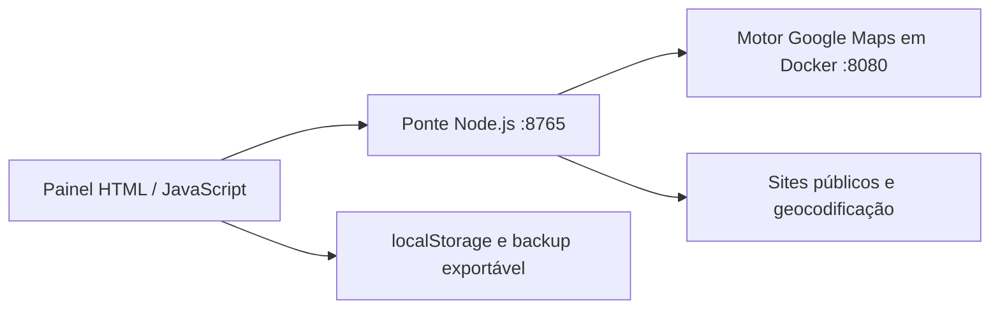

# Prospecta

Painel local de prospecção comercial: captura empresas no Google Maps, organiza contatos públicos e acompanha o relacionamento em um funil.

Projeto de portfólio de [RamiresAB](https://github.com/RamiresAB). Interface em português, com execução local e dados mantidos no navegador.

## O problema

Listas de empresas costumam ficar espalhadas entre planilhas, pesquisas e conversas. O Prospecta reúne descoberta, revisão de contatos e acompanhamento comercial em uma interface.

## Funcionalidades

- Captura de empresas no Google Maps por cidade, segmento e área de cobertura.
- Enriquecimento de sites com e-mails, redes sociais e evidências de WhatsApp publicado.
- Classificação de site e canal de contato, com revisão manual.
- Priorização de oportunidades conforme a oferta escolhida.
- Funil de Novo a Fechado/Perdido, notas e retornos.
- Mensagens editáveis e abertura de conversa; nenhum envio automático.
- Importação CSV/JSON, exportação e backup.
- Empresas fictícias para explorar a interface sem dados reais.

## Arquitetura



O painel e a API compartilham a mesma origem. A ponte limita o Host a endereços locais e exige `X-Prospecta` nas chamadas de API. A leitura de sites bloqueia endereços privados; esta versão deve permanecer restrita ao computador local.

## Executar

Pré-requisitos: Node.js 22 ou superior, Docker e Docker Compose. No Windows, deixe o Docker Desktop em execução.

```sh
docker compose up -d
node iniciar-prospecta.js
```

Abra **http://127.0.0.1:8765**. No Windows, também é possível executar `iniciar.bat`.

A busca Google por Serper é opcional: defina `SERPER_API_KEY` no ambiente ou use `configurar-busca.bat`. O arquivo `chave-serper.txt` é local e ignorado pelo Git. Buscas gratuitas podem sofrer bloqueios.

```sh
npm test
```

## Decisões técnicas

- Frontend sem framework ou etapa de compilação.
- Ponte Node com módulos nativos, sem dependências externas.
- Motor de captura isolado em contêiner, com versão fixada.
- Contato publicado e WhatsApp ativo são estados diferentes: a interface pede conferência.
- Leads ficam no navegador; exportar backup é necessário para transferir ou preservar a base.

## Limites e privacidade

Resultados de fontes públicas podem estar incompletos ou desatualizados. O sistema não confirma intenção de compra nem garante atividade de um número no WhatsApp. Revise identidade, região e origem antes de contatar alguém.

O repositório não contém listas reais de clientes, conversas, chaves ou backups comerciais. Não exponha as portas na internet. Limpar os dados do navegador remove a base local.

## Créditos

Motor externo: [gosom/google-maps-scraper](https://github.com/gosom/google-maps-scraper), licença MIT. Mapas e geocodificação utilizam OpenStreetMap e Nominatim, sujeitos às políticas dos serviços. O motor é um componente de terceiros; a interface e a integração deste repositório estão separadas dele.
